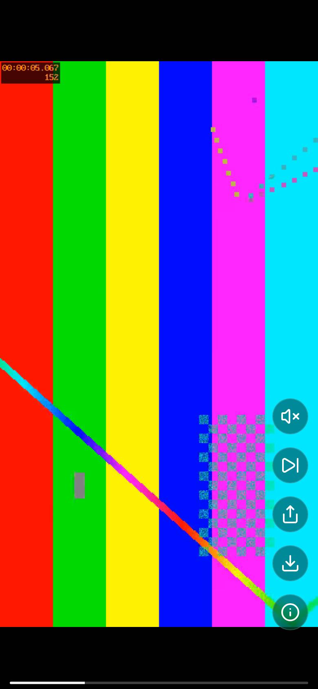

<p align="center">
  
</p>

<h1 align="center">forya</h1>

<p align="center">
  <b>A vertical video feed for your own clips.</b><br>
  Point it at a folder, open it on your phone, and swipe. Your files are never touched.
</p>

<p align="center">
  <a href="#quick-start">Quick start</a> ·
  <a href="#features">Features</a> ·
  <a href="docs/install.md">Install guide</a> ·
  <a href="docs/configuration.md">Configuration</a> ·
  <a href="#docs">Docs</a>
</p>

<p align="center">
  <a href="LICENSE"></a>
  
  
</p>

<p align="center">
  
</p>

forya is a self-hosted, TikTok-style feed for videos and photo galleries you already have. It shuffles your folder, plays one clip at a time, and handles seeking properly on iPhone Safari. It runs as one small container, needs no database, and mounts your media read-only.

## Quick start

You need [Docker with the Compose v2 plugin](https://docs.docker.com/compose/install/) and a folder with `.mp4`, `.mov`, `.webm` or `.m4v` files. There is no public image yet, so Compose builds one from source. Allow a few minutes for the first start.

1. Get the files:

   ```bash
   git clone https://github.com/mdbook/forya
   cd forya
   ```

2. Create a file named `.env` in that folder with your own **existing** video folder (use the absolute path, and keep the quotes if it has spaces):

   ```dotenv
   VIDEOS_PATH="/path/to/your/videos"
   FEED_NAME="My feed"
   ```

3. Start it:

   ```bash
   docker compose up -d --build
   ```

4. Open [localhost:3000](http://localhost:3000). Your clips show up after the first scan.

forya has no login, so by default it only accepts connections from the computer it runs on. To watch on your phone, see [access and authentication](docs/install.md#access-and-authentication).

Stop it with `docker compose down`. That keeps your favorites. `docker compose down -v` deletes them.

## Configuration

Settings are environment variables. With Compose, the common ones go in `.env`:

| Setting        | Default     | What it does                           |
| -------------- | ----------- | -------------------------------------- |
| `VIDEOS_PATH`  | required    | Host folder mounted read-only.         |
| `FEED_NAME`    | `feed`      | Feed title and home-screen name.       |
| `POSTERS`      | `false`     | Generate thumbnails and metadata.      |
| `BIND_ADDRESS` | `127.0.0.1` | Host address the port is published on. |

Tuning knobs like preload window, auto-advance and share links are in the [configuration reference](docs/configuration.md). Run the same start command again after changing `.env`.

## Features

- **A shuffled feed.** Every load is a fresh shuffle, with one clip playing at a time.
- **Built for iPhone Safari.** Correct HTTP Range support means playback and seeking work, and only nearby videos hold a decoder.
- **Videos and photo galleries.** Galleries can have a looping soundtrack.
- **Controls where your thumb is.** Play, pause, seek, mute, volume and next from on-screen controls. On a keyboard use Up/Down or `j`/`k`, Space and `m`.
- **Favorites.** Mark a clip and find it again at `/liked`.
- **Save and share.** Save a clip to your device, or share a link.
- **Home-screen app.** On iPhone use Share > Add to Home Screen.
- **Read-only by design.** forya only writes to its own optional data volume, never to your media.

## Docs

- [Install guide](docs/install.md): requirements, access and authentication, backups, updates, troubleshooting.
- [Configuration](docs/configuration.md): every setting, posters, tuning.
- [How it works](docs/architecture.md): media layout, playback, endpoints.
- [Changelog](CHANGELOG.md): version history.

## Contributing

Bug reports and pull requests are welcome. See [CONTRIBUTING.md](CONTRIBUTING.md) for setup and tests. Please do not attach private media or credentials to issues.

## License

[MIT](LICENSE) © Mikayla D. Burke
